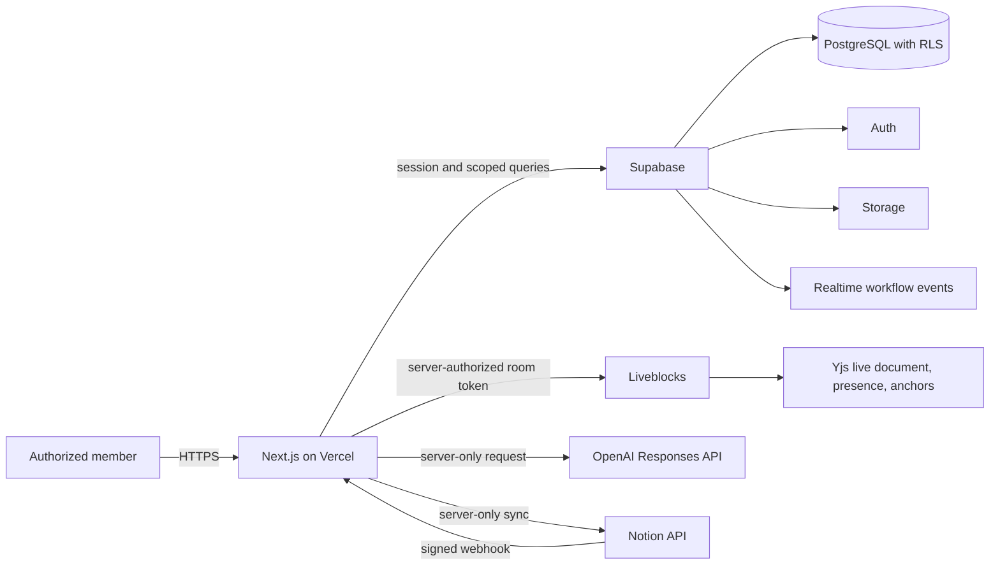

# CapItUp architecture

## Status and authority

This document describes the planned system boundaries and data flow derived from `docs/PRODUCT_SPEC.md`. It does not replace product requirements. Items marked **Open** must be resolved in `docs/DECISIONS.md` before implementation reaches them.

## System context

CapItUp is a private, organization-only Next.js App Router application deployed on Vercel. It uses Supabase for identity and durable application data, Liveblocks with TipTap and Yjs for managed realtime editing, OpenAI Responses API for server-authorized drafting assistance, and one organization-managed Notion internal integration for calendar and project metadata.

No standalone Express API is planned for the MVP. A persistent Hocuspocus service is an alternative only if the collaboration-hosting decision rejects managed Liveblocks.

## Responsibility boundaries

| Concern | Planned owner |
|---|---|
| Pages, route handlers, server actions, rendering | Next.js App Router |
| Authentication identity and session | Supabase Auth |
| Membership, roles, assignments, policies, metadata, workflow state | Supabase PostgreSQL with RLS |
| Immutable caption versions and final approvals | Supabase PostgreSQL |
| Attachments and reference assets | Supabase Storage with matching policies |
| Live editor state, selections, cursors, presence, text anchors | Liveblocks + TipTap + Yjs |
| Comment/suggestion authorization and durable audit metadata | Supabase; provider IDs/anchors reference the collaboration layer |
| Workflow notifications, reactions, activity updates | Supabase Realtime backed by durable records |
| Approved-example retrieval | PostgreSQL + `pgvector` |
| Caption generation | Server-side OpenAI Responses API |
| Calendar/project metadata source | Notion for explicitly mapped fields |
| Caption, version, decision, and approval source | CapItUp/Supabase |

**Open:** Before Phase 5, define whether the canonical body/status of anchored comment threads is mirrored into Supabase or retained by Liveblocks with only authorization/audit metadata in Supabase. The result must preserve export, retention, and audit requirements.

## Application organization

Use feature-oriented modules under `src/features/`, with shared primitives only where genuinely cross-cutting:

- `src/app/`: routes, layouts, route handlers, server actions, loading/error boundaries.
- `src/components/`: design-system primitives and shared composition.
- `src/features/auth/`: identity and membership UI/server adapters.
- `src/features/projects/`: projects, requests, assignments, deliverables, destinations.
- `src/features/captions/`: editor shell, versions, reactions, limits, Unicode conversion, search.
- `src/features/workflows/`: templates, instances, transitions, decisions, notifications.
- `src/features/collaboration/`: room authorization and provider/editor adapters.
- `src/features/ai/`: style profiles, retrieval, generation, quotas, provenance.
- `src/features/notion/`: mapping, sync, webhook, retry, conflict presentation.
- `src/lib/`: validated infrastructure adapters, authorization helpers, database clients, audit utilities.
- `src/types/`: shared stable types only; database-generated types remain generated.

Prefer React Server Components. Client components are limited to interactive forms, editor state, browser APIs, and realtime subscriptions. Untrusted input is validated at every server boundary with the repository schema library, planned as Zod unless Phase 0 establishes another choice.

## Durable data model

The exact SQL belongs in reviewed migrations. The logical groups are:

- Identity: `organizations`, `profiles`, `organization_memberships`, `organization_role_assignments`, `member_allowlist`, `project_assignments`, `access_security_events`.
- Projects and configuration: `projects`, `content_requests`, `content_formats`, `content_tags`, `content_format_tags`, `content_tag_requests`, `publication_channels`, `content_publication_channels`, `deliverables`, `caption_limit_policies`, `caption_limit_exceptions`.
- Workflow: `workflow_templates`, `workflow_template_steps`, `workflow_instances`, `workflow_instance_steps`, `approval_decisions`, `notifications`, `audit_events`.
- Caption work: `caption_items`, `caption_versions`, `collaboration_documents`, `caption_assignments`, `comments`, `comment_threads`, `suggestions`, `comment_mentions`, `reactions`, `attachments`.
- AI: `style_profiles`, `style_rules`, `style_samples`, `caption_embeddings`, `ai_generation_runs`, `ai_feedback`.
- Integrations: `integration_connections`, `notion_object_links`, `sync_cursors`, `sync_runs`, `webhook_events`, `dead_letter_events`.

Project assignments are temporal and separately auditable. Workflow instances are frozen copies of templates. Submitted caption versions store immutable editor JSON, plain text, normalized searchable text, and visible-character count. Formal decisions reference a version and the current workflow step. New content versions make prior decisions stale according to the approved invalidation rules.

## Key data flows

### Identity and membership

1. A user begins the selected institutional sign-in method.
2. Supabase verifies the identity.
3. A Before User Created hook checks the normalized verified identity against an invited allowlist entry.
4. The immutable auth subject is bound to the membership record.
5. Every request re-evaluates active membership, temporal assignments, and applicable roles through RLS and trusted server policy.

The exact provider, institutional domain, and fallback method are open decisions.

### Draft, submit, and approve

1. An authorized writer edits mutable working state.
2. Client and server use the same grapheme-counting and policy-resolution behavior; the server remains authoritative for persisted results.
3. Submission atomically serializes editor JSON, plain text, normalized text, and visible count into a new immutable `caption_version` and binds it to a frozen workflow instance.
4. Review decisions run through an atomic database function or transaction that checks actor authority, current step, and exact version.
5. Final approval locks the approved snapshot. A later content edit produces a new version and invalidates affected approvals.
6. Director override is a distinct transition requiring template permission, reason, exact version, audit event, visible label, and PRO notification.

### Realtime collaboration and snapshot handoff

1. A client requests room access from a Next.js server endpoint.
2. The server verifies the Supabase session, active organization membership, project access, current assignment, and requested capability.
3. The server issues only the minimum Liveblocks room permissions.
4. Liveblocks/Yjs synchronizes the working document, presence, selections, and anchors.
5. Submission reads a consistent document state and creates the immutable Supabase version; approval never targets the moving Yjs document.

### AI generation

1. The server verifies membership, project access, AI entitlement/quota, and the confirmed brief.
2. Retrieval filters approved/published examples by the requester's authorized scope before similarity search.
3. The server sends explicit rules, a versioned prompt, and a small approved example set to OpenAI.
4. Structured JSON is validated before display or storage.
5. The run records model, prompt version, style profile version, sample IDs, output, editor, and disposition where practical.
6. Output enters the editor only as visibly AI-assisted draft or suggestion content.

### Notion synchronization

1. A narrow internal integration reads Notion-owned event/project fields from explicitly shared content.
2. CapItUp-owned status/deep-link fields may flow back only after the field map is accepted.
3. Signed webhook events are deduplicated, persisted, and used to fetch the current authoritative Notion object.
4. Sync uses cursors/timestamps, idempotent writes, retry with backoff, dead-letter handling, and visible conflicts.
5. Working caption versions remain app-only; final-caption export is optional and unresolved.

## Consistency and concurrency

- Use database constraints for controlled tags, uniqueness, references, valid status values, and reaction cardinality.
- Use transactions or database functions for state transitions, snapshot creation, approval invalidation, override, and related audit events.
- Use optimistic concurrency on mutable metadata and drafts where provider CRDT semantics do not apply.
- Do not derive authorization from user-editable metadata, client claims, URLs, room IDs, or Notion identities.
- Store workflow step separately from overall caption status.
- Soft-delete recoverable content; do not silently delete audit history.

## Search and normalization

Search operates over canonical plain text and normalized searchable text, never decorative Unicode alone. Filters include project, writer, platform, content format, status, date range, hashtag/campaign, approval actor, and full-text keyword. Historical approved captions remain searchable subject to organization and project authorization.

## Deployment and operational topology

- Vercel hosts the Next.js application, server routes, AI streaming, room authorization, and webhook handlers.
- Supabase hosts Auth, PostgreSQL/RLS, Storage, Realtime, and `pgvector`.
- Managed Liveblocks is the planned collaboration provider unless the open hosting decision selects persistent self-hosted Hocuspocus on Render or Fly.io.
- Secrets exist only in server deployment configuration or an appropriate encrypted secret store.
- Phase 0 creates placeholder-only `.env.example`; no real service connection is authorized by the plan.

## Architectural fitness checks

- No browser bundle contains service-role, OpenAI, Notion, Liveblocks-secret, webhook, or encryption keys.
- Direct database and route requests produce the same authorization outcome.
- Cross-organization IDs cannot disclose row existence or content.
- A submitted version remains byte-for-byte stable while the live draft changes.
- Workflow template edits do not alter active instances.
- AI retrieval cannot return inaccessible project samples.
- Replayed Notion events do not duplicate writes.
- Loss of AI or Notion does not block core caption drafting, approval, export, or recovery.

