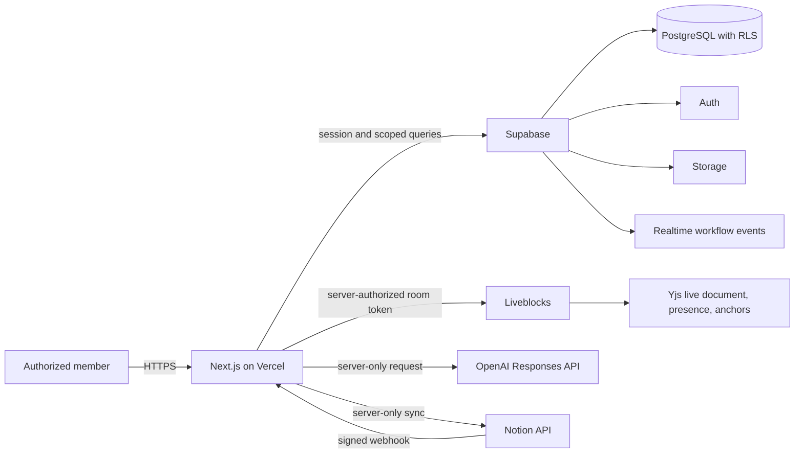

# CapItUp architecture

## Status and authority

This document describes the planned system boundaries and data flow derived from `docs/PRODUCT_SPEC.md`. It does not replace product requirements. Items marked **Open** must be resolved in `docs/DECISIONS.md` before implementation reaches them.

## System context

CapItUp is a private, organization-only Next.js App Router application deployed on Vercel. It uses Supabase for identity and durable application data, Liveblocks with TipTap and Yjs for managed realtime editing, OpenAI Responses API for server-authorized drafting assistance, and one organization-managed Notion internal integration for calendar and project metadata.



No standalone Express API is planned for the MVP. A persistent Hocuspocus service is an alternative only if the collaboration-hosting decision rejects managed Liveblocks.

## Responsibility boundaries

| Concern | Planned owner |
|---|---|
| Pages, route handlers, server actions, rendering | Next.js App Router |
| Authentication identity and session | Supabase Auth |
| Membership, roles, assignments, policies, metadata, workflow state | Supabase PostgreSQL with RLS |
| Immutable caption versions and final approvals | Supabase PostgreSQL |
| Attachments and reference assets | Supabase Storage with matching policies |
| Live editor state, selections, cursors, presence, text anchors | Liveblocks + TipTap + Yjs |
| Comment/suggestion authorization and durable audit metadata | Supabase; provider IDs/anchors reference the collaboration layer |
| Workflow notifications, reactions, activity updates | Supabase Realtime backed by durable records |
| Approved-example retrieval | PostgreSQL + `pgvector` |
| Caption generation | Server-side OpenAI Responses API |
| Calendar/project metadata source | Notion for explicitly mapped fields |
| Caption, version, decision, and approval source | CapItUp/Supabase |

**Open:** Before Phase 5, define whether the canonical body/status of anchored comment threads is mirrored into Supabase or retained by Liveblocks with only authorization/audit metadata in Supabase. The result must preserve export, retention, and audit requirements.

## Application organization

Use feature-oriented modules under `src/features/`, with shared primitives only where genuinely cross-cutting:

- `src/app/`: routes, layouts, route handlers, server actions, loading/error boundaries.
- `src/components/`: design-system primitives and shared composition.
- `src/features/auth/`: identity and membership UI/server adapters.
- `src/features/projects/`: projects, requests, assignments, deliverables, destinations.
- `src/features/captions/`: editor shell, versions, reactions, limits, Unicode conversion, search.
- `src/features/workflows/`: templates, instances, transitions, decisions, notifications.
- `src/features/collaboration/`: room authorization and provider/editor adapters.
- `src/features/ai/`: style profiles, retrieval, generation, quotas, provenance.
- `src/features/notion/`: mapping, sync, webhook, retry, conflict presentation.
- `src/lib/`: validated infrastructure adapters, authorization helpers, database clients, audit utilities.
- `src/types/`: shared stable types only; database-generated types remain generated.

Prefer React Server Components. Client components are limited to interactive forms, editor state, browser APIs, and realtime subscriptions. Untrusted input is validated at every server boundary with Zod under A-013.

## Phase 01 foundation boundary

The user-requested Phase 01 foundation establishes only the local application and tooling boundary. It does not activate the full system context above.

- `src/app/layout.tsx` and `src/app/page.tsx` provide a minimal Server Component shell with semantic landmarks and no product workflow.
- Tailwind CSS supplies baseline global styling. shadcn/ui supplies reusable primitives through the configured aliases, but Phase 01 adds no final branding or screen system.
- `src/lib/env/` owns typed environment parsing. Public and server schemas are separate modules so client code cannot import a server-secret object accidentally.
- Zod is the planned schema library because the product specification and repository instructions both prefer it when no competing schema library is established.
- Variables for later integrations remain represented in `.env.example` but are validated only when their owning feature or server adapter is activated. This keeps a credential-free foundation build possible without treating empty strings as valid credentials.
- `supabase/` is local development configuration only. Phase 01 may start and stop the local container stack, but it does not link a hosted project or create product tables, Auth hooks, Storage buckets, or RLS business policies.
- Vitest and Testing Library own unit/component tests. Playwright owns the local browser smoke test. Neither test suite may depend on a hosted service in this phase.

The foundation dependency direction is:

```text
src/app and client-safe components -> public environment schema only
server-only adapters              -> server environment schema
tests                              -> synthetic environment values and local processes
local Supabase CLI                 -> local containers only
```

Later phases may add feature adapters beneath these boundaries; they must not collapse the public/server environment split or make optional integrations a prerequisite for unrelated builds.

## Phase 02 offline authentication boundary

Phase 02 adds an offline implementation of the authentication and organization-membership boundary without linking or mutating a Supabase project. The hosted development project is the eventual execution environment, but its configuration and migration application require a separate authorized step.

- `supabase/migrations/20261024000100_phase_02_auth_membership.sql` is the version-controlled schema and policy source. It defines organizations, identity requirements, profiles, allowlist entries, memberships, role assignments, authentication security events, constraints, indexes, trusted functions, grants, and RLS.
- `src/lib/supabase/browser.ts` creates a browser client from only the public URL and publishable/legacy anonymous key. `src/lib/supabase/server.ts` creates a request-scoped cookie client and is guarded by `server-only`. No service-role client is part of the application runtime.
- `src/proxy.ts` refreshes Supabase session cookies and performs optimistic redirects. Page-level server authorization still calls `requireActiveMembership`; Proxy is not the trusted authorization boundary.
- `/auth/callback` exchanges the provider code, invokes the transactional membership claim, rechecks current access, and redirects only to a validated internal path. `/access-denied` and the sign-in action use generic responses.
- Organization administration is exposed only through server-only helpers backed by narrow SQL functions. The functions derive the actor from `auth.uid()`, require a current same-organization `org_admin`, and do not trust browser-supplied actor or organization claims.
- Existing workspace routes remain fixture-only and do not implement project or caption behavior, but they now require an authenticated user with a current active membership.
- `src/types/database.ts` is migration-derived for the credential-free pass. It must be compared with Supabase-generated types after the migration is applied to an authorized development project.

The offline dependency direction is:

```text
client sign-in form                 -> server action -> Supabase publishable client
auth callback / protected pages    -> request-scoped server client -> RLS / trusted RPC
organization administration helper -> active same-org admin check -> trusted RPC
browser table access               -> explicit SELECT policy only; direct writes denied
```

The selected institutional provider, approved domains, role-display rule, and hosted abuse controls remain open decisions. The current email-link action is deployment-inactive scaffolding and does not settle those product choices.

## Phase 03 offline projects and content boundary

The user-directed Phase 03 slice implements projects, temporal project assignments, and controlled content-record metadata without beginning caption drafting or collaboration. The implementation is reviewable offline; no database migration or RLS policy has been applied to a hosted project.

- `supabase/migrations/20261025000100_phase_03_projects_content.sql` is the additive schema source. It adds project/content types, controlled catalogs, organization-scoped records, composite foreign keys, temporal exclusion constraints, optimistic versions, trusted functions, audit events, grants, and RLS.
- `project_assignments` is the project-membership record. It remains separate from `organization_role_assignments`. `content_item_assignments` separately records writer/reviewer responsibility and has no approval authority.
- Content kinds and kind/tag compatibility are constrained in catalog relations and repeated in shared server-boundary validation. The migration seeds only the product-spec taxonomy. Publication-channel rows remain empty while O-009 is unresolved.
- Next.js Server Actions are thin network entry points. `src/features/projects/data.ts` is the server-only data-access layer, rechecks the current Supabase user/membership, returns minimal DTOs, and delegates mutations to narrow database functions.
- Browser roles receive RLS-filtered `SELECT` access only. Multi-row creation, metadata replacement, assignment changes, deliverable creation, optimistic concurrency, and audit writes occur in security-definer functions that derive the actor from `auth.uid()`.
- `/projects`, `/projects/new`, project detail, content creation, and content detail/edit routes provide the minimum responsive interface. The only client component is the interactive controlled-taxonomy form; it imports no server-only module.
- Deliverables are HTTP(S) links only. Attachments, Storage, caption bodies, immutable caption versions, formal workflow transitions, and collaboration remain absent.

The Phase 03 request path is:

```text
browser form
  -> Next.js Server Action (Zod validation)
  -> server-only request-scoped Supabase client
  -> authenticated RPC (auth.uid-derived actor and resource checks)
  -> constrained organization/project rows + append-only audit evidence
```

`src/types/database.ts` is migration-derived manually for this disconnected pass. It must be compared with types generated from the authorized hosted development schema after both pending migrations are applied.

## Durable data model

The exact SQL belongs in reviewed migrations. The logical groups are:

- Identity: `organizations`, `profiles`, `organization_memberships`, `organization_role_assignments`, `member_allowlist`, `project_assignments`, `access_security_events`.
- Projects and configuration: `projects`, `content_requests`, `content_formats`, `content_tags`, `content_format_tags`, `content_tag_requests`, `publication_channels`, `content_publication_channels`, `deliverables`, `caption_limit_policies`, `caption_limit_exceptions`.
- Destination-policy extension: private launch templates plus organization-scoped `publication_channel_policies` and policy/content-format mappings. The templates initialize the owner-supplied v1 manual-publication catalog without placing limits in UI components.
- Workflow: `workflow_templates`, `workflow_template_steps`, `workflow_instances`, `workflow_instance_steps`, `approval_decisions`, `notifications`, `audit_events`.
- Caption work: `caption_items`, `caption_versions`, `collaboration_documents`, `caption_assignments`, `comments`, `comment_threads`, `suggestions`, `comment_mentions`, `reactions`, and deliverable-link references.
- AI: `style_profiles`, `style_rules`, `style_samples`, `caption_embeddings`, `ai_generation_runs`, `ai_feedback`.
- Integrations: `integration_connections`, `notion_object_links`, `sync_cursors`, `sync_runs`, `webhook_events`, `dead_letter_events`.

Project assignments are temporal and separately auditable. Workflow instances are frozen copies of templates. Submitted caption versions store immutable editor JSON, plain text, normalized searchable text, word count, applicable platform-specific counts, and the exact evaluated length-policy version references and values. Formal decisions reference a version and the current workflow step. New content versions make prior decisions stale according to the approved invalidation rules.

## Key data flows

### Identity and membership

1. A user begins the selected institutional sign-in method.
2. Supabase verifies the identity.
3. A Before User Created hook checks the normalized verified identity against an invited allowlist entry.
4. The immutable auth subject is bound to the membership record.
5. Every request re-evaluates active membership, temporal assignments, and applicable roles through RLS and trusted server policy.

The exact provider, institutional domain, and fallback method are open decisions.

### Draft, submit, and approve

1. An authorized writer edits mutable working state.
2. Client and server use the same versioned word-counting, platform-specific counting, and policy-resolution behavior; the server remains authoritative for persisted results. Character-based platform limits use grapheme counting unless the verified provider rule says otherwise.
3. Submission atomically serializes editor JSON, plain text, normalized text, word count, applicable platform-specific counts, and evaluated policy-version references and values into a new immutable `caption_version`, then binds it to a frozen workflow instance.
4. Review decisions run through an atomic database function or transaction that checks actor authority, current step, and exact version.
5. Final approval locks the approved snapshot. A later content edit produces a new version and invalidates affected approvals.
6. Director override is a distinct transition requiring template permission, reason, exact version, audit event, visible label, and PRO notification.

### Length-policy administration

1. A `publicity_director` or `pro` creates or edits a draft word-recommendation policy in settings, optionally scoped to a controlled tag or destination.
2. A `publicity_director`, `pro`, or `executive` makes the activation decision through a narrow audited server operation. This does not grant executives general settings or caption-editing access.
3. Activation assigns the immutable policy version an absolute effective timestamp administered in `Asia/Manila`. Changing an active policy creates a successor rather than updating it in place.
4. Policy resolution records the exact version IDs and evaluated values on the submitted caption version, keeping historical evaluation reproducible after a successor activates.

### Destination character-limit validation

1. An authorized initializer copies the approved private v1 destination templates into organization-scoped, versioned policies without overwriting existing policy versions.
2. The editor resolves every selected destination's current policy and computes a separate visible-grapheme count that includes all text, URLs, hashtags, mentions, whitespace, punctuation, and emoji.
3. Validation returns the precise failing destination(s); a later ready-for-publication workflow blocks only when one or more selected destination limits are exceeded.
4. Caption versions and formal decisions retain policy-version references so supersession never rewrites historical validation.

### Realtime collaboration and snapshot handoff

1. A client requests room access from a Next.js server endpoint.
2. The server verifies the Supabase session, active organization membership, project access, current assignment, and requested capability.
3. The server issues only the minimum Liveblocks room permissions.
4. Liveblocks/Yjs synchronizes the working document, presence, selections, and anchors.
5. Submission reads a consistent document state and creates the immutable Supabase version; approval never targets the moving Yjs document.

### AI generation

1. The server verifies membership, project access, AI entitlement/quota, and the confirmed brief.
2. Retrieval filters approved/published examples by the requester's authorized scope before similarity search.
3. The server sends explicit rules, a versioned prompt, and a small approved example set to OpenAI.
4. Structured JSON is validated before display or storage.
5. The run records model, prompt version, style profile version, sample IDs, output, editor, and disposition where practical.
6. Output enters the editor only as visibly AI-assisted draft or suggestion content.

### Notion synchronization

1. A narrow internal integration reads Notion-owned event/project fields from explicitly shared content.
2. CapItUp-owned status/deep-link fields may flow back only after the field map is accepted.
3. Signed webhook events are deduplicated, persisted, and used to fetch the current authoritative Notion object.
4. Sync uses cursors/timestamps, idempotent writes, retry with backoff, dead-letter handling, and visible conflicts.
5. Working caption versions remain app-only; final-caption export is optional and unresolved.

## Consistency and concurrency

- Use database constraints for controlled tags, uniqueness, references, valid status values, and reaction cardinality.
- Use transactions or database functions for state transitions, snapshot creation, approval invalidation, override, and related audit events.
- Use optimistic concurrency on mutable metadata and drafts where provider CRDT semantics do not apply.
- Do not derive authorization from user-editable metadata, client claims, URLs, room IDs, or Notion identities.
- Store workflow step separately from overall caption status.
- Soft-delete recoverable content; do not silently delete audit history.

## Search and normalization

Search operates over canonical plain text and normalized searchable text, never decorative Unicode alone. Filters include project, writer, platform, content format, status, date range, hashtag/campaign, approval actor, and full-text keyword. Historical approved captions remain searchable subject to organization and project authorization.

## Deployment and operational topology

- Vercel hosts the Next.js application, server routes, AI streaming, room authorization, and webhook handlers.
- Supabase hosts Auth, PostgreSQL/RLS, Storage, Realtime, and `pgvector`.
- Managed Liveblocks is the planned collaboration provider unless the open hosting decision selects persistent self-hosted Hocuspocus on Render or Fly.io.
- Secrets exist only in server deployment configuration or an appropriate encrypted secret store.
- Phase 0 creates placeholder-only `.env.example`; no real service connection is authorized by the plan.
- Phase 01 verifies a credential-free local build and local-only Supabase lifecycle. Hosted Supabase, Vercel configuration, and all production secrets remain outside the phase.

## Architectural fitness checks

- No browser bundle contains service-role, OpenAI, Notion, Liveblocks-secret, webhook, or encryption keys.
- Direct database and route requests produce the same authorization outcome.
- Cross-organization IDs cannot disclose row existence or content.
- A submitted version remains byte-for-byte stable while the live draft changes.
- Workflow template edits do not alter active instances.
- AI retrieval cannot return inaccessible project samples.
- Replayed Notion events do not duplicate writes.
- Loss of AI or Notion does not block core caption drafting, approval, export, or recovery.

