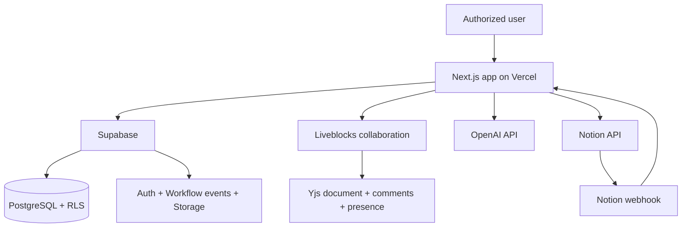

# Publicity Caption Tracker — Product and Build Brief

> Working title: **CapItUp**. Alternatives: **PubDesk**, **CaptionDesk**, or **CopyTrack**.
>
> This document is intended to be placed in the repository as `docs/PRODUCT_SPEC.md` and used as the primary product source for Codex CLI.

## 1. Executive recommendation

Build the first version as a **private, organization-only web application** using:

- **Next.js with TypeScript** for the web app and server-side API routes
- **Vercel** for the Next.js deployment
- **Supabase** for PostgreSQL, Auth, Row Level Security, workflow events, Storage, and `pgvector`
- **Liveblocks + TipTap + Yjs** for Google Docs-style live text collaboration, cursors, anchored comments, and presence
- **OpenAI Responses API** for caption drafting and rewriting
- **Notion API** through one organization-managed internal connection for the first release
- **Tailwind CSS + shadcn/ui** for a maintainable design system
- **TipTap** for the caption editor, with optional paid Tracked Changes if full suggestion mode is required
- **Playwright + Vitest** for end-to-end and unit testing

Do **not** add a separate Express server for the MVP. Next.js route handlers are enough for authentication callbacks, AI requests, Notion webhooks, and ordinary business logic. Add an Express service on Render or Fly.io only if the project later requires a long-running custom WebSocket server, heavy background processing, or an API used by several separate clients.

Liveblocks owns the active Yjs document, live cursors, text selections, presence, and provider snapshots. Supabase owns users, permissions, durable comments/replies/mentions/resolutions, suggestions, reactions, workflow state, immutable submitted versions, approvals, audit records, and application notifications. Durable text anchors retain Yjs-relative positions so they continue to follow nearby edits. The app does not maintain its own WebSocket service.

CapItUp is the source of truth for captions, versions, comments, and approval history. Notion is the source of truth for posting metadata. CapItUp may import explicitly mapped title and schedule fields, but it never reads or writes caption text or approval state through Notion.

## 2. The refined product idea

CapItUp is a centralized workspace where a publicity team can:

1. Import or create a publicity request.
2. Assign one or more writers.
3. Draft and version a caption for a post, reel, story, announcement, or other content type.
4. Receive advisory feedback from teammates.
5. Move the selected caption version through the required approval chain.
6. Produce AI-assisted drafts using an organization or personal writing style.
7. Store the final approved version with a complete decision and edit history.
8. Reflect relevant dates and statuses in the organization’s Notion database.

The product is more than a caption archive. Its core value is a **versioned editorial workflow**: everyone can see what changed, who approved which version, what still blocks publication, and which text was actually published.

### Primary outcomes

- One searchable place for all publicity captions
- Clear ownership and deadlines
- Less confusion over “which version is final”
- Role-aware approvals without relying on Messenger threads
- Reusable institutional writing style
- AI assistance without automatic publishing or removing human responsibility
- A permanent audit trail for overrides and approval decisions

### Explicit non-goals for the MVP

- Automatic posting to Facebook, Instagram, TikTok, or LinkedIn
- A public signup page open to anyone
- AI-generated images or publication materials
- Automatic AI approval of captions
- Full two-way synchronization of every Notion page block
- Training or fine-tuning a custom model
- Serving multiple unrelated organizations or Notion workspaces

## 3. Terminology

Use these terms consistently in the database, UI, and code:

- **Organization role** — a person’s ongoing role in the organization
- **Project assignment** — a temporary responsibility within one project
- **Workflow template** — an ordered list of approval steps
- **Workflow instance** — the frozen copy of a template used by one caption
- **Caption item** — the container for a caption task and its metadata
- **Caption version** — an immutable snapshot of caption text
- **Decision** — an approval, request for changes, or authorized override tied to one version
- **Reaction** — non-binding team feedback
- **Final approved version** — the immutable version cleared for publication

Avoid calling every user role a “permission level.” A user may hold a permanent organization role and a temporary project assignment at the same time.

## 4. Roles and permission model

### 4.1 Organization roles

| Role | Meaning | Default abilities |
|---|---|---|
| `junior_officer` | The ordinary writer/member role | Create drafts, edit assigned drafts, comment, react, and submit for review |
| `publicity_director` | Publicity lead | All writer abilities, review captions, request changes, configure ordinary assignments, and use an audited final-approval override when permitted |
| `pro` | Public Relations Officer | All writer abilities and ordinary final approval |
| `executive` | Executive-board observer | View permitted projects only; no comment, reaction, edit, or decision unless assigned a project role |
| `org_admin` | Technical access administrator | Manage membership, access, integration settings, and workflow templates; this is not automatically an editorial approval role |

Every publicity director and PRO retains writer abilities. The application must support more than one role per person if the organization eventually needs it, but the UI may show one primary title.

### 4.2 Project assignments

Project assignments are scoped to one project and should have `starts_at`, `ends_at`, `assigned_by`, and `revoked_at` fields.

- `publicity_head`
- `co_project_head`
- `project_head`
- `writer`
- `viewer`

An executive becomes actionable only when assigned one of the head roles for that project. Outside that project, the executive remains read-only.

### 4.3 Advisory feedback

Use two friendly, non-binding reactions:

- **Looks Ready** — equivalent to positive confidence
- **Needs Refinement** — indicates that the reviewer sees room for improvement

Require a short comment when someone selects **Needs Refinement**. This prevents the reaction from feeling like a vague downvote. Reactions do not count as formal approval and cannot move the workflow forward.

### 4.4 Permission rules

| Action | Junior officer | Publicity director | PRO | Executive | Assigned project head |
|---|:---:|:---:|:---:|:---:|:---:|
| View an accessible project | Yes | Yes | Yes | Yes | Yes |
| Create a caption | Yes | Yes | Yes | No | If explicitly allowed by assignment |
| Edit an assigned draft | Yes | Yes | Yes | No | If assigned as editor |
| Comment/react | Yes | Yes | Yes | No | Yes, within assigned project |
| Submit a version | Yes | Yes | Yes | No | If acting as a writer |
| Decide a workflow step | No | When step permits | When step permits | No | Only for matching assigned step |
| Ordinary final approval | No | No | Yes | No | Only if workflow explicitly ends at that role |
| Emergency final approval | No | Audited override only | Yes | No | No |
| Manage organization access | No | Optional delegation | Optional delegation | No | No |

Authorization must be enforced in PostgreSQL Row Level Security and server-side functions, not only by hiding buttons in the UI.

## 5. Approval workflows

Do not hard-code one global hierarchy. Each project chooses a workflow template, and the selected steps are copied into a workflow instance so that later edits to a template do not change work already in progress.

### 5.1 Standard publicity workflow

Publicity Director review is mandatory for every standard caption. A standard caption cannot skip directly to final approval.

1. Writer submits a specific caption version.
2. Publicity Director reviews it.
3. Publicity Director either recommends it or requests changes.
4. PRO gives final approval or requests changes.

A PRO-authored caption cannot be independently self-approved by its author. It must use one frozen independent-approval path: Publicity Director only, an existing `executive` with an explicit President designation, or unanimous active Junior Officers. A President designation is authorization data separate from a display title; the website owner may grant or revoke it, while a Publicity Director may revoke it. Each change requires a reason and immutable audit record. The unanimous-Junior-Officer snapshot includes every active `junior_officer` at workflow creation; a snapshot member who later becomes suspended, expired, resigns, or is marked temporarily unavailable by a Publicity Director or PRO with an audit reason does not block completion.

### 5.2 Project-led workflow

Use the applicable subset of these steps:

1. Publicity Head
2. Co-Project Head
3. Project Head
4. Publicity Director
5. PRO

Each step is individually configurable as required or skipped. For example, a project may require `publicity_head → project_head → publicity_director → PRO`, while a smaller project may need only `publicity_head → PRO`.

### 5.3 Director override

The Publicity Director may give final approval only when all of the following are true:

- The workflow template allows an override.
- A specific reason is entered.
- The exact approved caption version is recorded.
- The event and actor are written to the audit log.
- The PRO is notified.
- The UI visibly labels the decision **Director Override**, not ordinary PRO approval.

An override must never silently impersonate another approver.

### 5.4 Version and approval behavior

- Every submission and decision references a `caption_version_id`.
- Editing caption text creates a new immutable version.
- A content edit after approval invalidates approvals for the previous version.
- A new version normally restarts the workflow at the earliest required review step.
- Changing only the scheduled publication time preserves existing approval. Any change to caption content, title, content kind, tags, destination platforms, deliverable links, content assignments, special-case settings, or the evaluated policy invalidates the affected approval and moves the content into a new review state. Historical versions and decisions remain immutable.
- The final approved text is locked. Further changes require creating another version and reopening approval.
- Use optimistic concurrency with a version number or `updated_at` check to prevent silent overwrites.

### 5.5 Suggested status names

- `draft`
- `in_review`
- `changes_requested`
- `awaiting_final_approval`
- `approved`
- `scheduled`
- `published`
- `archived`

The workflow step and the overall caption status should be stored separately. This avoids awkward statuses such as `waiting_for_co_project_head` appearing throughout the code.

## 6. Core feature set

### 6.1 Dashboard

- My assigned captions
- Captions waiting for my decision
- Deadlines this week
- Recently updated captions
- Upcoming events imported from Notion
- Workload by writer
- Quick AI drafting entry point

### 6.2 Post record structure

Use **content format** for the top-level `Post`, `Video`, or `Article` choice. Use **content tags** for the approved labels beneath that format. This avoids using “post type” for two different concepts.

Each record contains:

- Post title
- Content format: `post`, `video`, or `article`
- One or more approved content tags
- Caption working document
- One or more deliverable links from other committees
- Publication destinations
- Project/event and scheduled publication date
- Caption deadline
- Assigned writers
- Assigned checking/review roles
- Workflow template
- Special-case indicator and reason
- Character-limit policy resolved for the record
- Notion source link, when imported
- Status, timestamps, and audit history

Model deliverables as child records rather than one text field so a post may later have a publication material, video, registration form, article draft, or other committee output. A deliverable record should contain `label`, `url`, `source_committee`, `deliverable_type`, and optional `status`.

CapItUp uses deliverable links only. A creative image, video, article, Canva file, Drive file, registration material, or other media reference is stored as a separate deliverable-link record rather than embedded in the caption body. Do not create file-upload UI, a Storage bucket, attachment rows, malware scanning, public asset URLs, or upload/download behavior. The link exists to help the publicity team find the media supplied by the Creative or Media Committee while preparing a manual post.

Model destinations through an organization-managed `publication_channels` table and a many-to-many relation. Examples may include Facebook, Instagram, LinkedIn, website, and other approved channels. Do not hard-code one destination into the caption record.

### 6.3 Approved content tags

Users may select multiple tags, but only tags allowed for the selected content format. Enforce the relationship in the database and server validation, not only in the dropdown.

#### Article

- `GENERAL 📄`
- `ANNOUNCEMENT 📢`
- `EVENT 📰`
- `STORY 🖼️`

#### Video

- `VIDEO 📽️`
- `AVP 🎥`
- `REEL 🎥`

#### Post

- `GENERAL 📄`
- `BIRTHDAY 🎂`
- `ANNOUNCEMENT 📢`
- `EVENT 📰`
- `BRANDING 🗞️`
- `STORY 🖼️`
- `HN ‼️`
- `HOLIDAY 🗓️`

Store the tags in the database as seeded controlled vocabulary rather than embedding the list throughout the frontend. Each tag has an internal stable slug, display label, emoji, active flag, and allowed content format. Existing records retain retired tags, but retired tags cannot be selected for new records.

If a user cannot find an appropriate tag, offer:

1. **Suggest closest approved tag** — rule-based first, with optional AI explanation.
2. **Request new tag** — captures proposed label, use case, requester, and examples for Director/admin review.

Users cannot create arbitrary tags from the caption form.

### 6.4 Caption workspace

- Post metadata and publication destinations
- Assigned writers, reviewers, and project heads
- Google Docs-style collaborative TipTap editor
- Live named cursors and selections
- Comment threads anchored to selected text
- Suggesting mode with accept/reject controls
- Unicode Style Converter for selected text
- Visible-character counter and limit state
- Platform-aware preview
- Hashtag and call-to-action fields
- Version history and visual diff
- Looks Ready / Needs Refinement reactions
- Approval timeline and current blocker
- Activity/audit timeline
- AI assistant panel

### 6.5 Live document and review behavior

Each caption item has one active collaborative draft room. Authorized writers can type simultaneously and see remote text, selections, cursors, names, and presence nearly immediately.

Use this state model:

1. **Editing mode** — assigned writers and permitted leads directly edit the shared Yjs document.
2. **Comment mode** — a user selects text and starts a thread anchored to that range.
3. **Suggesting mode** — edits become attributed proposed insertions/deletions that an authorized writer or reviewer can accept or reject.
4. **Submitted snapshot** — submission serializes the current editor JSON and plain text into an immutable Supabase `caption_version`.
5. **Review lock** — ordinary writers cannot silently change the submitted snapshot. They may work in a new draft or respond through comments/suggestions according to workflow policy.
6. **Approved snapshot** — final approval always references the immutable Supabase version, not the moving live document.

Comments attach to selected text ranges rather than visual “line 12,” because lines move when the editor width or content changes. Store the durable thread body, document ID, author, status, timestamps, mentions, workflow visibility, and encoded Yjs-relative positions in Supabase. The relative positions keep the thread attached as nearby content changes.

Use managed Liveblocks with its TipTap/Yjs integration for synchronized documents, presence, cursors, selections, reconnection, and exact provider snapshots. Supabase stores durable comments, mentions, resolutions, suggestions, reactions, and notifications. Full TipTap Tracked Changes is not required; use the narrower suggestion record selected by A-026, containing the anchored range, original text, proposed replacement, author, and review state.

### 6.6 Unicode Style Converter

The Lingojam-like feature is a **Unicode Style Converter**, not ordinary bold or italic formatting. It replaces Latin letters and supported digits with Unicode Mathematical Alphanumeric Symbols so the appearance remains after copying into social platforms.

Provide these options for selected text:

| Style key | Label | Example |
|---|---|---|
| `bold_serif` | Bold (serif) | `𝐅𝐢𝐓` |
| `bold_sans` | Bold (sans) | `𝗙𝗶𝗧` |
| `bold_italic_serif` | Italic Bold (serif) | `𝑭𝒊𝑻` |
| `bold_italic_sans` | Italic Bold (sans) | `𝙁𝙞𝙏` |
| `fraktur_bold` | Medieval Bold | `𝕱𝖎𝕿` |
| `double_struck` | Double-Struck | `𝔽𝕚𝕋` |

Requirements:

- Apply conversion only to the current selection.
- Show a preview before applying.
- Include **Remove Unicode Style** using a tested reverse mapping.
- Leave unsupported characters unchanged and tell the user which characters were skipped.
- Do not transform URLs, email addresses, `@mentions`, or hashtags by default because it can break link detection and search.
- Preserve editor undo/redo and collaborative attribution.
- Index a normalized plain-text shadow for search, AI retrieval, diffs, and accessibility checks.
- Warn that decorative Unicode may be read poorly by assistive technology and may reduce searchability. Recommend it for short headings or emphasis, not an entire caption.

Keep the Unicode mapping tables in a tested code utility because the mapping is application behavior. Keep the list of styles enabled for the organization in database settings if administrators should be able to disable specific styles.

### 6.7 Length recommendations, platform limits, and special cases

Store length policies in the database, not as frontend constants. Organization recommendations are measured in words; verified destination-platform hard limits retain the unit and counting algorithm defined by that platform. The organization expects recommendations to change by term, format, tag, or destination, so hard-coding would require a redeploy and leave old records ambiguous.

Initial organization recommendations for caption copy are:

- `post`: 120 words.
- `video`: 100 words.
- `article`: 200 words.

These values are the initial policies the organization intends to enter through application settings, not compiled constants, migration seeds, permanent defaults, or limits on an article's full body. Until an authorized user activates the applicable policy, show that no organization recommendation is configured rather than silently applying a code fallback. Verified platform hard limits still apply independently.

Use a versioned `caption_limit_policies` table with:

- Organization
- Optional content format
- Optional content tag
- Optional publication channel
- Measurement unit and counting-algorithm version
- Recommended maximum words
- Configurable approaching-warning threshold
- Optional platform hard maximum, unit, counting algorithm, source, and verification date
- Effective timestamp stored as an absolute instant and presented for policy administration in `Asia/Manila` (Philippine Standard Time, UTC+08:00)
- Optional effective end or academic term
- Version, lifecycle status, creator, activation decision maker, and change reason

Allow authorized users to configure content-kind defaults and optional controlled-tag or destination overrides in application settings. Do not encode those overrides in components. Resolve the most specific active policy. If several selected tags or destinations produce different recommendations, show the strictest applicable recommendation and explain which rule produced it.

`publicity_director` and `pro` may author or edit a draft policy version. A `publicity_director`, `pro`, or `executive` may decide whether that version becomes active. This policy-activation decision is a narrow exception to the default executive read-only rule; it does not grant an executive permission to edit captions or other organization settings. Every create, edit, activation, rejection, retirement, and supersession action must be authorized server-side and audited.

Policy versions are append-only after activation. Editing an active policy creates a new version with its own effective timestamp rather than modifying the old row. Every submitted caption version records the exact policy-version identifiers and evaluated values used at submission. Historical views must show both that Caption A was evaluated under Policy v1 and the complete Policy v1 values even after Policy v2 becomes active. Retiring or superseding a policy must not remove it from historical evaluations.

The recommended maximum produces a warning, not a submission block. Display `Within recommendation`, `Approaching recommendation`, `Over recommendation`, and, when applicable, `Special-case exemption`. The approaching threshold is policy data and must not be hard-coded. A verified external platform maximum uses a separate `Over platform maximum` state and may block export or publication, but must be labeled separately.

Special-case exception data must retain:

- The `is_special_case` indicator and request justification.
- Requester and request timestamp.
- The selected approval template and a frozen snapshot of its rules for the relevant caption version.
- Each version-bound approval or rejection decision rather than one mutable `exception_approved_by` field.
- Grant, rejection, and revocation timestamps and actors when applicable.
- Optional `exception_max_visible_characters`.

When an approved special case applies, continue displaying the counter but replace the normal length warning with a neutral **Special-case exemption** indicator. Platform hard limits still apply.

Special-case exception requests are version-bound. A `junior_officer`, `publicity_director`, or `pro` may request an exception, and the request must include a trimmed justification of at least 50 characters. A requester may approve their own request only when acting as a `publicity_director` or `pro`; a `junior_officer` may not self-approve.

Each task selects an exception-approval template or preset. The template selects one or more of these independent approver categories:

- The `publicity_director` organization role.
- The project's `publicity_head` assignment.
- The `pro` organization role.
- The `executive` organization role when the person also holds an active `co_project_head` or `project_head` assignment for that project.

The template defines whether one selected category is sufficient (`any_of`) or every selected category is required (`all_of`). It must also explicitly define how rejection completes the request; rejection behavior must not be inferred from UI order or hard-coded role precedence. Freeze the selected template and its rules when the caption version is submitted so later template edits cannot change an in-progress or historical decision.

A decision reason or remark is optional for approval or rejection. Revocation requires a reason and may be performed by an eligible `executive` or `pro`. Organization roles and project assignments remain separate authorization inputs; a person may hold more than one without one enum inheriting from another.

Creating or submitting a changed caption version invalidates the prior version's approval or exception outcome and requires approval for the new immutable version. Exception decisions and revocations must never be retargeted to a mutable working document.

Append-only audit records must retain the content item ID, immutable version ID, action (`submitted`, `approved`, `rejected`, `exception_granted`, or `exception_revoked`), actor ID, the actor's applicable organization role and project assignment at the time, timestamp, reason or remarks when applicable, previous status, and new status. Audit history remains immutable when content is edited or superseded.

Notify the content owner or submitter when content is approved or rejected, an exception is granted or revoked, or a new version causes a previously approved item to require re-approval. Notify eligible approvers when a new or modified version is submitted and requires their decision.

Count organization recommendations in words using one shared, versioned client/server algorithm. Do not substitute a naive whitespace split. The current algorithm is:

- An apostrophe inside a non-hyphenated term does not split it: `Let's` is one word.
- A hyphen separates nonempty components: `FEU-Tech's` is two words, and an apostrophe within a component does not split it further.
- Numbers and alphanumeric terms are one word: `10th` is one word.
- Each standalone emoji grapheme is one word because it is meaningful graphical content.
- An HTTP(S) or `www.` URL is one word regardless of its length.
- A hashtag is zero words: `#FITGames2026` contributes no word.
- A mention is one word: `@everyone` is one word.
- Do not attempt language-specific segmentation. A word-like continuous non-whitespace sequence in a language or writing system without whitespace separation is one word.

The resolved policy for the content's specific controlled tag supplies the recommendation. The policy configuration also supplies a 40-word approaching offset and a global hard maximum of 400 words; these values are versioned policy/configuration data rather than implementation constants. With a 200-word tag recommendation, Normal is 0–159 words, Approaching recommendation is 160–200, Exceeds recommendation is 201–400, and Exceeds hard maximum is 401 or more.

When a destination's verified hard limit is character-based, count **visible user-perceived characters**, technically extended grapheme clusters, unless the provider documents a different algorithm. This makes `👍🏽`, `🇵🇭`, and `👨‍👩‍👧‍👦` count as one each even though JavaScript string length reports multiple UTF-16 code units.

Use one shared function on client and server:

```ts
const graphemes = new Intl.Segmenter(undefined, { granularity: "grapheme" })

export function countVisibleCharacters(value: string): number {
  return Array.from(graphemes.segment(value.normalize("NFC"))).length
}
```

For the generic grapheme counter, spaces, punctuation, and line breaks each count as one visible character. When applicable, show the word-based organization recommendation and the platform-specific hard-limit counter as separate labeled measurements.

### 6.7.1 Launch publication destinations

The application prepares and validates content for manual publication only. It does not schedule or publish to external platforms. The owner-supplied, approved `v1` destination policy is stored as versioned configuration data in `Asia/Manila`, not in UI components.

| Channel slug | Display label | Allowed content kinds | Character limit | Classification |
| --- | --- | --- | ---: | --- |
| `facebook` | Facebook | post, video | 63,206 | Platform-based |
| `facebook_story` | FB Story | post, video | 2,000 | Organization-defined destination |
| `facebook_community` | Facebook Community | post | 63,206 | Organization-defined, platform-aligned |
| `instagram` | Instagram | post, video | 2,200 | Platform-based |
| `instagram_story` | Instagram Story | post, video | 2,000 | Organization-defined destination |
| `group_chat` | Group Chats | post | 2,000 | Organization-defined destination |
| `x` | X (Twitter) | post | 280 | Platform hard limit for standard posts |
| `tiktok` | TikTok | video, post | 4,000 | Platform-based |
| `youtube` | YouTube | video | 5,000 | Platform hard limit for video descriptions |
| `discord` | Discord | post | 2,000 | Platform hard limit for standard messages |
| `linkedin` | LinkedIn | post | 3,000 | Platform hard limit for posts |
| `acm_website` | ACM Website | post, article | 4,000 | Temporary organization-defined |

Destination character counts include letters, numbers, whitespace, punctuation, hashtags, mentions, URLs, and emoji. They do not reuse O-029 word-count exclusions. Validate every selected destination independently and identify the specific failing channel. A content item above an applicable destination maximum cannot advance to ready-for-publication until corrected. The current app has no ready-for-publication workflow; this rule is enforced when that later workflow is implemented.

The FB Story, Instagram Story, Facebook Community, and Group Chats values are intentional organization-managed limits, not verified provider hard limits. The `x` policy assumes standard 280-character posts and excludes Premium longer-post allowances. The Discord policy assumes the standard 2,000-character message limit and excludes Nitro's 4,000-character allowance. The ACM Website limit is a configurable temporary organization-defined value.

Superseded destination policies remain stored. Content versions and formal review/approval records must retain the exact destination-policy version used for their historical evaluation.

Test at least ordinary ASCII, combining accents, skin-tone emoji, flag emoji, family/ZWJ emoji, line breaks, and all supported Unicode style conversions. Visible count is a writing-policy measure, not byte size; if a social platform documents a different counting algorithm, keep a separate platform-specific counter.

### 6.8 Search and archive

Filter by:

- Project
- Writer
- Platform
- Content type
- Status
- Date range
- Hashtag or campaign
- Approval actor
- Full-text keyword

### 6.9 Notifications

Start with in-app notifications for:

- New assignment
- Mention or reply
- Changes requested
- Approval requested
- Final approval
- Upcoming deadline
- Director override

Email notification delivery is deferred until an email provider, sender domain, authentication, and delivery policy are separately configured. In-app notification records remain the durable source of notification state.

Messenger integration is outside the MVP unless an official organization-approved integration is available.

## 7. User experience direction

Use the referenced Dribbble work for visual direction, not as a screen to copy pixel-for-pixel.

### 7.1 Dashboard visual language

The dashboard reference uses glass-like cards, restrained gradients, dark foundations, clear spacing, and an AI productivity layout. Translate that into:

- Dark navy/black application shell
- Frosted panels used sparingly for hierarchy
- Soft lavender and violet accents
- Orange only for urgent deadlines or attention states
- Large, calm spacing instead of dense enterprise tables everywhere
- A left navigation rail, central work area, and optional right assistant/activity rail

Suggested starting tokens:

| Token | Value |
|---|---|
| Background | `#05060B` |
| Light surface/text | `#ECF0F8` |
| Lavender | `#9CA7DE` |
| Muted slate | `#4D506E` |
| Violet | `#6C72AC` |
| Attention | `#EC630D` |

Adjust these to the organization’s actual branding before implementation.

### 7.2 Login experience

Use a centered glassmorphic login card over a subtle abstract gradient. Keep the form simple because this is an invitation-only app:

- “Continue with Institutional Account” as the primary action
- Google sign-in as the primary institutional-account choice
- A collapsed "Use email instead" control in the lower part of the card. It reveals an institutional email/password fallback only when the member chooses it; it does not send a magic link.
- No open “Create account” flow
- A clear “This workspace is limited to authorized members” message
- Generic access-denied messages that do not reveal whether an email is on the membership list

### 7.3 Accessibility requirements

- Meet WCAG 2.2 AA contrast targets
- Full keyboard navigation
- Visible focus states
- Labels for all icon-only controls
- Reduced-motion support
- Never rely on color alone for approval state
- Avoid placing long caption text over translucent or animated backgrounds
- Provide a plain-text preview for decorative Unicode and warn before styling long selections

## 8. Recommended architecture



### 8.1 Frontend and application layer

- Next.js App Router
- React Server Components by default
- Client components only where interaction or realtime subscriptions require them
- Next.js route handlers for OpenAI, Notion, and privileged server operations
- Zod schemas shared between forms and server handlers
- React Hook Form for forms
- TipTap editor backed by Yjs for captions
- Liveblocks client and server authorization for collaborative rooms
- shadcn/ui primitives customized into the project’s own design system

### 8.2 Supabase responsibilities

- PostgreSQL as the primary data store
- Supabase Auth for institutional identity
- RLS for organization and project permissions
- Realtime for workflow status, reactions, activity, and general app notifications
- `pgvector` for retrieving relevant approved caption examples
- Edge Functions or database jobs for asynchronous embedding and sync tasks when needed

### 8.3 Collaboration responsibilities

| Concern | Owner |
|---|---|
| Live characters, cursors, selections, editor presence | Liveblocks + Yjs |
| Durable anchored comments, replies, mentions, suggestions, and resolutions | Supabase PostgreSQL with Yjs-relative anchors |
| User identity and room authorization | Supabase Auth + server-issued room access |
| Post metadata, assignments, tags, and deliverables | Supabase PostgreSQL |
| Immutable submitted and approved versions | Supabase PostgreSQL |
| Approval state and audit trail | Supabase PostgreSQL |
| Workflow notifications and reactions | Supabase Realtime |

Never trust a client-provided room name or role. A Next.js server endpoint must verify the Supabase session, organization membership, project access, and editing permission before granting collaboration-room access.

## 9. Hosting decision

### Recommended: Vercel + Supabase

This remains the best fit for the web application. Vercel hosts the Next.js UI, collaboration authorization endpoint, route handlers, webhook endpoints, and AI streaming. Use Liveblocks or TipTap Cloud for the persistent collaborative document connections.

Vercel Functions can now accept WebSockets, so a custom collaboration server is technically possible. However, Function connections remain subject to invocation duration and lifecycle behavior. A managed collaboration provider is the lower-risk starting point for durable documents, reconnection, cursor awareness, comment anchors, and version history.

### When Render is better

Choose Render if the team self-hosts a persistent Hocuspocus/Yjs service or adds Express workers. Render supports long-lived web services and inbound WebSockets, but free services may sleep and introduce cold starts.

### When Fly.io is better

Choose Fly.io if the team needs Docker-level control, specific regional placement, custom networking, or a persistent application process and accepts more operational work.

### Why not start with an Express service

Adding Express at the beginning would create another deployment, another security boundary, duplicated request validation, and more operational work without solving an MVP requirement. Keep business logic in reusable server modules so that it can later move behind Express if necessary.

## 10. Database design

The exact SQL should be produced through migrations. The following model is the product contract.

### 10.1 Identity and membership

- `organizations`
- `profiles`
- `organization_memberships`
- `organization_role_assignments`
- `member_allowlist`
- `project_assignments`
- `access_security_events`

Important membership fields:

- `status`: `invited`, `active`, `suspended`, `expired`
- `valid_from` and `valid_until`
- normalized institutional email
- immutable Supabase user ID once claimed
- optional admin-verified student/employee identifier
- who invited, suspended, or restored access

Do not authorize users by comparing only the username portion before `@`. Use an exact normalized email or immutable identity-provider subject, then bind it to the invited membership record.

### 10.2 Projects and requests

- `projects`
- `content_requests`
- `content_formats`
- `content_tags`
- `content_format_tags`
- `content_tag_requests`
- `publication_channels`
- `content_publication_channels`
- `deliverables`
- `caption_limit_policies`
- `caption_limit_exceptions`
- `project_assignments`
- `workflow_templates`
- `workflow_template_steps`
- `workflow_instances`
- `workflow_instance_steps`

### 10.3 Caption work

- `caption_items`
- `caption_versions`
- `collaboration_documents`
- `caption_assignments`
- `comments`
- `comment_threads`
- `suggestions`
- `comment_mentions`
- `reactions`
- `approval_decisions`
- `notifications`
- `audit_events`

### 10.4 AI and style data

- `style_profiles`
- `style_rules`
- `style_samples`
- `caption_embeddings`
- `ai_generation_runs`
- `ai_feedback`

### 10.5 Integrations

- `integration_connections`
- `notion_object_links`
- `sync_cursors`
- `sync_runs`
- `webhook_events`
- `dead_letter_events`

Never store raw integration secrets in ordinary exposed tables. Use deployment secrets or an appropriate encrypted secret store.

### 10.6 Required invariants

- Only active organization members can access organization data.
- An executive without a relevant project assignment is read-only.
- One reaction type per user, caption version, and reaction category.
- Only approved tags associated with the selected content format can be attached.
- A submitted version stores immutable editor JSON, plain text, normalized searchable text, word count, applicable platform-specific counts, and the exact evaluated policy-version references and values.
- Collaboration-room access is granted only after server-side organization and project authorization.
- An approved limit exception suppresses only the organization recommendation, never a documented platform hard limit.
- A formal decision is valid only for the actor’s current workflow step.
- Final approval references exactly one immutable version.
- A new content version marks prior decisions stale.
- Every role, assignment, approval, override, and integration write creates an audit event.
- Soft-delete ordinary content where recovery matters; never silently delete audit history.

## 11. Authentication and access security

### 11.1 Recommended login model

Use Supabase Auth with institutional Google OAuth as the primary sign-in method. Provide an email/password fallback when Google OAuth is unavailable or a member deliberately chooses the collapsed lower-page email option. Do not use email magic links as a fallback.

The fallback must use an approved institutional email, a confirmed email where Supabase requires confirmation, and the same allowlist/current-membership checks as OAuth. It is a recovery path, not a way to self-register or bypass the invitation boundary.

Before allowing user creation, check the normalized verified email against `member_allowlist`. Supabase provides a Before User Created hook that can reject unauthorized signups. Public self-registration should remain disabled.

Notion OAuth should not be the main login system. A member may use a personal email for Notion, and Notion page authorization is an integration permission rather than proof that the person belongs to the publicity committee.

### 11.2 Better handling of the “five failed attempts” idea

A blanket 24-hour lock on an email after five attempts is possible but creates a denial-of-service weakness: someone else can deliberately lock a legitimate member’s email.

Use this safer design:

- Prefer Google OAuth. Apply equivalent anti-brute-force controls to the email/password fallback.
- Apply Supabase’s built-in Auth rate limits.
- Track denied access attempts using an email hash plus IP/device risk signals.
- Show the same generic result for unknown and unauthorized identities.
- Require CAPTCHA after repeated attempts.
- Use progressive cooldowns such as 5, 15, and 60 minutes.
- After five high-confidence abusive attempts, block the **IP + identifier pair** for up to 24 hours rather than globally disabling the member.
- Let an administrator clear a security block.
- Do not count Notion connection failures as application login failures.

### 11.3 Security requirements

- Enable RLS on every exposed table.
- Keep the Supabase service-role key server-only.
- Keep OpenAI and Notion secrets server-only.
- Do not place authorization roles in user-editable metadata.
- Validate every privileged action again on the server.
- Verify Notion webhook signatures and store event IDs for idempotency.
- Add CSRF/state protection to OAuth callbacks.
- Sanitize rich text and generated HTML.
- Set Content Security Policy and secure cookies.
- Log role changes, approval overrides, membership changes, and integration writes.
- Add CAPTCHA and rate limiting before public deployment.

## 12. Notion integration strategy

### 12.1 Recommended first release: one internal connection

For one organization workspace, ask a Notion workspace owner to create an internal connection, grant the content-read and content-update capabilities needed to read posting metadata and update the existing Caption embed, and share only the calendar data source and posting pages with it. Store the token as a server secret. No CapItUp URL database property is required.

Advantages:

- Members do not need to connect their own Notion accounts.
- The organization owns the integration instead of one student’s account.
- Access stays limited to explicitly shared content.
- Offboarding one team member does not break the integration.

### 12.2 When to use Notion OAuth

Use a public OAuth connection only if CaptionFlow becomes a multi-workspace product or every user must make changes in Notion under their own identity. OAuth can return workspace and authorizing-user information, but it should remain separate from CaptionFlow membership authorization.

### 12.3 Calendar behavior

First determine what “our Notion calendar” means:

- If it is a **Notion database displayed as a calendar view**, the API can query the underlying data source and current APIs can also work with database views.
- If it is an external calendar displayed through the separate Notion Calendar product, do not assume that the Notion database API exposes those personal calendar events. That may require the original Google or Microsoft Calendar API instead.

### 12.4 Recommended source-of-truth mapping

| Field | Initial source of truth | Sync direction |
|---|---|---|
| Posting title and schedule | Notion | Notion → app through explicit title/date mappings |
| Platform, assignees, and schedule status | Notion | Notion only; untouched by CapItUp sync |
| Working caption versions | App only | No sync |
| Caption text and approvals | CapItUp | No sync to Notion |
| CapItUp entry link | CapItUp | App → Notion, update the URL of the existing Caption embed block |

Use Notion webhooks to detect metadata changes and then fetch the authoritative page. Webhooks are near-real-time rather than guaranteed instant UI transport, so Supabase/Liveblocks remain responsible for live caption collaboration. Keep the existing bold `Caption` label and its immediately following top-level embed block in each posting page. After a Notion posting row is bound to one CapItUp content item, the explicit Retry Link Sync action locates that unique block and updates its embed URL to `/projects/{projectId}/content/{contentItemId}/open`. The `/open` route sends authorized editors to the editor and viewers to the read-only view with Copy Caption. Never read or write caption text through this link bridge. Missing or ambiguous Caption blocks and Notion API errors are retryable and must not block local editing or approvals.

### 12.5 Conflict policy

- Do not allow both systems to freely edit the same field in the MVP.
- Store the Notion page ID and last synced edit timestamp.
- Make sync jobs idempotent.
- Retry transient errors with backoff.
- Place repeatedly failing events in a dead-letter table for manual review.
- Show the last successful sync and any conflict in the admin UI.

## 13. AI writing assistance

### 13.1 What “learn our style” should mean

Do not start with fine-tuning. Use **retrieval-augmented generation (RAG)**:

1. Store only selected, approved, and preferably published caption examples.
2. Create embeddings for those examples.
3. At generation time, retrieve a small set matching the project, platform, content type, campaign, or author style.
4. Send the user’s brief, explicit style rules, and retrieved examples to the model.
5. Return structured caption variants for human editing.

This is easier to update, cheaper to test, and less likely to preserve old mistakes than automatically training on every historical draft.

### 13.2 Style profiles

Support:

- **Organization Default** — managed by the Publicity Director or PRO
- **Campaign Style** — temporary rules for one campaign
- **Personal Style** — owned by one writer and opt-in

A style profile should contain explicit rules such as:

- Tone and level of formality
- Typical sentence length
- Emoji density and placement
- Hashtag conventions
- Preferred calls to action
- Words or clichés to avoid
- Capitalization rules
- Examples of good openings and closings
- Target audience

Use 5–20 curated examples before adding more. Quality and relevance matter more than volume.

### 13.3 Initial AI actions

- Generate three caption directions from a brief
- Shorten or lengthen a selected caption
- Make the wording sound more natural
- Match organization or personal style
- Produce platform-specific variants
- Check grammar and clarity
- Suggest a hook, CTA, or hashtags
- Compare the draft against a publicity checklist

AI output must create a draft or suggestion, never an approval or published version.

### 13.4 Structured output

Have the model return validated JSON containing fields such as:

- `variants[]`
- `tone`
- `hook`
- `body`
- `cta`
- `hashtags[]`
- `assumptions[]`
- `warnings[]`

Validate it with Zod before displaying or storing it.

### 13.5 AI safety, privacy, and cost controls

- Never expose the API key to the browser.
- Require the user to confirm the brief before generation.
- Do not retrieve captions from projects the user cannot access.
- Exclude drafts and rejected captions from the learning corpus by default.
- Allow authors to opt out of personal-style sampling.
- Record the model, prompt version, retrieved sample IDs, output, editor, and final disposition.
- Set per-user and per-organization quotas.
- Cache embeddings and do not regenerate them unnecessarily.
- Show users which style profile and examples influenced the generation.
- Require human review before submission and approval.

## 14. Suggested project structure

```text
captionflow/
├── AGENTS.md
├── README.md
├── docs/
│   ├── PRODUCT_SPEC.md
│   ├── ARCHITECTURE.md
│   ├── SECURITY.md
│   └── DECISIONS.md
├── harness/
│   ├── build/
│   ├── context/
│   └── build-log.md
├── src/
│   ├── app/
│   ├── components/
│   ├── features/
│   ├── lib/
│   └── types/
├── supabase/
│   ├── migrations/
│   ├── functions/
│   └── seed.sql
├── tests/
│   ├── e2e/
│   ├── integration/
│   └── unit/
└── .env.example
```

Organize most application code by feature rather than putting every component or server function into one large shared directory.

## 15. Environment variables

Create `.env.example` with placeholders only:

```dotenv
NEXT_PUBLIC_APP_URL=
NEXT_PUBLIC_SUPABASE_URL=
NEXT_PUBLIC_SUPABASE_ANON_KEY=
SUPABASE_SERVICE_ROLE_KEY=
LIVEBLOCKS_SECRET_KEY=
OPENAI_API_KEY=
NOTION_API_TOKEN=
NOTION_CALENDAR_DATABASE_ID=
NOTION_CALENDAR_DATA_SOURCE_ID=
NOTION_WEBHOOK_SECRET=
APP_ENCRYPTION_KEY=
```

Never place real values in `.env.example`, commits, screenshots, prompts, or issue descriptions.

## 16. Development setup

### Accounts and access to prepare

- GitHub repository
- Supabase project
- Vercel project
- Organization-owned OpenAI API project
- Organization-owned Notion connection
- Notion workspace-owner assistance for the internal connection and content sharing
- Institutional Google OAuth configuration if available

### Local tools

- Git
- Current Node.js LTS
- `pnpm` or `npm` — choose one and commit its lockfile
- Supabase CLI
- Codex CLI
- VS Code or another editor

### Suggested scaffold commands

Run these manually or ask Codex to run them during the approved foundation phase:

```bash
npx create-next-app@latest captionflow --typescript --tailwind --eslint --app --src-dir --import-alias "@/*"
cd captionflow
npm install @supabase/ssr @supabase/supabase-js @notionhq/client openai zod react-hook-form @hookform/resolvers date-fns lucide-react
npm install @liveblocks/client @liveblocks/react @liveblocks/react-tiptap yjs @tiptap/react @tiptap/pm @tiptap/starter-kit
npm install -D vitest @testing-library/react @testing-library/jest-dom @playwright/test
npx shadcn@latest init
npx supabase init
```

Use the current official installation instructions if a package has changed by the time implementation starts.

## 17. Implementation roadmap

Keep phases small enough to review and test independently.

### Phase 0 — Repository and decisions

- Initialize repository, formatter, linting, tests, and environment example
- Add product, architecture, security, and decision documents
- Create `AGENTS.md`, build phases, and build log
- No external integrations or real credentials

### Phase 1 — UI foundation and application shell

- Design tokens and responsive layout
- Login screen shell
- Dashboard shell
- Accessible components and navigation
- Static representative data only

### Phase 2 — Authentication, membership, and RLS

- Supabase Auth
- Invitation/allowlist workflow
- Organization roles and project assignments
- Before User Created hook
- RLS policies and authorization tests
- Security event logging

### Phase 3 — Caption drafting and version history

- Projects and content requests
- Content formats, controlled tags, tag requests, destinations, and deliverables
- Caption item creation and assignments
- Configurable word-based recommendation policies and special-case exceptions
- Shared versioned word counter plus grapheme-aware counters for character-based platform limits
- Unicode Style Converter with normalized search text
- Editor, immutable snapshots, and reactions
- Optimistic concurrency
- Search and filters

### Phase 4 — Approval workflow

- Workflow templates and frozen instances
- Standard and project-led chains
- Changes requested loop
- PRO final approval
- Director override with audit evidence
- Notifications

### Phase 5 — Realtime collaboration

- Yjs-backed simultaneous text editing
- Live cursors, selections, and presence
- Text-anchored comments and mentions
- Suggesting mode with accept/reject behavior
- Snapshot handoff from live document to approval version
- Live workflow status and reactions
- Notification center
- Reconnection, offline recovery, and room-authorization behavior

### Phase 6 — AI assistance

- Explicit style profiles
- Curated approved samples
- Embeddings and filtered retrieval
- Structured caption generation
- Quotas, logging, and evaluation fixtures

### Phase 7 — Notion integration

- Internal connection
- Calendar/data-source import
- Field mapping and outbound status sync
- Webhook verification and idempotency
- Retry and conflict UI

### Phase 8 — Hardening and pilot

- Full RLS and privilege review
- Accessibility audit
- End-to-end workflow tests
- Backup and recovery exercise
- Pilot with a small real team
- Measure approval time, revision loops, and user confusion

Do not implement AI and Notion before the core caption and approval workflow is reliable. Otherwise, integration work will hide weaknesses in the actual product.

## 18. Testing strategy

### Unit tests

- Permission evaluator
- Workflow transition rules
- Version invalidation
- Style-profile prompt construction
- Notion field mapping
- Input schemas
- Tag/content-format validation
- Unicode style mapping and reverse mapping
- Grapheme-cluster counting and limit-policy resolution

### Database/RLS integration tests

Create seeded personas for:

- Junior Officer A
- Junior Officer B
- Publicity Director
- PRO
- Executive without assignment
- Executive assigned as Project Head
- Suspended user

Test both allowed and denied operations. Hiding a button is not evidence that the database is secure.

### End-to-end tests

- Authorized login
- Unauthorized access rejection
- Writer creates and submits a version
- Director requests changes
- Writer submits a replacement version
- Prior approval becomes stale
- PRO approves the exact new version
- Executive remains read-only
- Assigned executive completes the correct project-head step
- Director override records reason and notification
- Two writers type concurrently without lost edits
- A comment remains anchored after nearby text changes
- A suggestion is attributed and can be accepted or rejected
- A submitted collaborative document becomes an immutable approval version
- Unauthorized users cannot join or observe a collaboration room
- Composite emoji count as one visible character
- An approved special case removes only the recommended-limit warning
- Notion webhook replay does not duplicate work

### AI evaluation fixtures

Maintain a small set of briefs with expected characteristics, not one exact required caption. Score:

- Factual consistency with the brief
- Style adherence
- CTA presence
- Platform length limits
- Avoided phrases
- Human edit distance and acceptance rate

## 19. MVP acceptance criteria

The MVP is ready for a controlled pilot when:

- Only invited active members can enter.
- Unauthorized roles cannot bypass permissions through direct requests.
- Writers can create, version, comment on, and submit captions.
- Looks Ready and Needs Refinement work as advisory feedback.
- The standard Director-to-PRO workflow works end to end.
- One configurable project-head workflow works end to end.
- Every decision references the correct caption version.
- Editing approved text reopens approval.
- An override is visually distinct and audited.
- Concurrent caption text, cursors, selections, anchored comments, and suggestions work between two browser sessions.
- Content format and multi-tag selections follow the approved vocabulary.
- Word recommendations and approaching thresholds come from the active database policy rather than frontend constants.
- Historical caption versions retain the exact policy versions and evaluated values used at submission.
- Composite emoji count as one visible character for generic character-based platform limits, and special cases are visibly exempted only from organization recommendations.
- Unicode styles can be applied and removed without breaking undo, collaboration, or normalized search.
- Search returns historical approved captions.
- The app survives a refresh without losing draft/version state.
- The main workflow passes Playwright tests.
- RLS policies pass positive and negative tests.
- The team can export or recover final captions if an integration is unavailable.

AI and Notion are valuable additions, but neither should block the first internal usability test of the core workflow.

## 20. How to prompt Codex CLI effectively

### 20.1 The best method

Do not use one giant “build the whole app” prompt. Give Codex durable repository context, then execute one bounded phase at a time.

Use this hierarchy:

1. `AGENTS.md` — durable repository instructions, conventions, and boundaries
2. `docs/PRODUCT_SPEC.md` — product behavior and decisions
3. `PLANS.md` or `harness/build/*.md` — phase sequence and acceptance criteria
4. Current prompt — only the immediate phase, evidence required, and stop condition
5. `harness/build-log.md` — what was actually completed and verified

An effective implementation prompt contains:

- **Objective** — one concrete outcome
- **Sources** — files Codex must read
- **Scope** — what it may change
- **Non-goals** — what it must not start
- **Constraints** — architecture, security, and style decisions
- **Acceptance criteria** — observable behavior
- **Verification** — commands/tests it must actually run
- **Stop condition** — where to hand control back

### 20.2 First Codex session: create the planning harness

Place this file at `docs/PRODUCT_SPEC.md`, start Codex from the repository root, run `/init`, review the generated `AGENTS.md`, then use:

```text
Read AGENTS.md and docs/PRODUCT_SPEC.md completely.

This task is planning only. Do not create application code, install dependencies,
connect external services, use credentials, deploy, commit, or push.

Create or conservatively update:
- PLANS.md
- docs/ARCHITECTURE.md
- docs/SECURITY.md
- docs/DECISIONS.md
- harness/build/phase-00-repository-foundation.md through the final planned phase
- harness/build-log.md

Keep the product spec authoritative. Mark ambiguities as open decisions instead of
inventing requirements. Each phase must include objective, dependencies, in-scope
work, non-goals, expected files, security considerations, acceptance criteria,
verification commands, evidence to record, and a stop condition.

After writing, check the documents for contradictions and run git diff --check.
Report the files changed, assumptions, unresolved decisions, and verification
evidence. Stop after the planning artifacts are complete.
```

### 20.3 Foundation phase prompt

```text
Read AGENTS.md, docs/PRODUCT_SPEC.md, PLANS.md, the Phase 0 build file, and the
current harness/build-log.md. Inspect the repository before changing anything.

Implement only Phase 0. Do not begin authentication, database business tables,
AI, Notion, or deployment. Do not use real credentials. Preserve all unrelated
user changes.

Before implementation, state the files you expect to change and any blocker that
would materially change the architecture. Then implement the smallest complete
foundation, add tests/configuration required by the phase, and run every relevant
format, lint, typecheck, unit-test, and build command.

Update harness/build-log.md with observed evidence only. Do not claim a command
passed unless you ran it. Finish with changed files, commands and results,
assumptions, and remaining risks. Stop at the end of Phase 0; do not deploy,
commit, or push.
```

### 20.4 Reusable phase execution prompt

```text
Read the applicable AGENTS.md files, docs/PRODUCT_SPEC.md, PLANS.md,
harness/build/<SELECTED_PHASE>.md, relevant prior phase context, and
harness/build-log.md. Inspect the live repository as the source of truth.

Implement only <SELECTED_PHASE> and satisfy its acceptance criteria. Respect its
non-goals and dependency boundaries. Do not begin the next phase. Do not deploy,
commit, push, rotate credentials, or change external services.

Use a red-green-refactor approach where practical:
1. Add or identify the smallest failing test/check for the behavior.
2. Implement the minimum correct behavior.
3. Refactor without expanding scope.
4. Run focused checks and then the relevant broader suite.

Pay special attention to authorization and negative tests. Update the build log
with actual results. Finish with changed files, migrations, security implications,
commands and results, manual checks still required, and unresolved risks. Stop
after this phase.
```

### 20.5 UI implementation prompt

```text
Implement the approved UI-foundation phase using docs/PRODUCT_SPEC.md as the
behavioral source and its UX section as visual direction. The Dribbble references
are inspiration only; do not copy their proprietary composition or assets.

Create an original responsive design system with a dark foundation, restrained
glass surfaces, lavender accents, clear hierarchy, and accessible contrast.
Implement the login shell, navigation, dashboard shell, caption workspace shell,
loading/empty/error states, keyboard focus states, and reduced-motion behavior.

Use representative local fixtures only. Do not connect Auth, OpenAI, or Notion in
this phase. Verify desktop and mobile layouts, run accessibility checks available
in the repo, and capture evidence in the build log. Stop after the UI phase.
```

### 20.6 Security review prompt

```text
Review the current implementation against docs/SECURITY.md and the authorization
requirements in docs/PRODUCT_SPEC.md. This is a read-only review unless I later
authorize fixes.

Trace every role and project assignment through UI, server handlers, database
grants, RLS policies, storage policies, and realtime channels. Attempt to find
privilege escalation, insecure direct object references, service-role exposure,
membership bypass, stale-assignment access, approval spoofing, version/approval
mismatch, webhook replay, and secret leakage.

Return findings ordered by severity. For each finding include evidence, affected
files/policies, a reproducible scenario, impact, and a minimal remediation. Clearly
separate confirmed findings from hypotheses and list the tests needed to verify
each hypothesis. Do not modify files, deploy, commit, or push.
```

### 20.7 Prompting habits to keep

- Ask for observed evidence, not “make sure it works.”
- Name the exact phase and stop condition.
- Reference the spec instead of pasting it again.
- Tell Codex what not to start.
- Keep credentials and deployment behind separate explicit tasks.
- Require negative permission tests, not only happy-path tests.
- Review migrations and RLS before moving to the next phase.
- Use a fresh branch for a substantial phase and inspect the diff before merging.
- If Codex makes an assumption that changes product behavior, add the decision to `docs/DECISIONS.md`.

## 21. Decisions to make before implementation reaches them

These do not block repository planning, but they must be resolved before their related phase:

1. Is institutional Google OAuth available, or must the approved email/password fallback be used?
2. What is the exact institutional email domain?
3. Is the current Notion calendar a database calendar view or the separate Notion Calendar product?
4. Which Notion properties already exist?
5. Should the Publicity Director review be required for every standard caption?
6. Can the PRO write and submit their own caption directly to final approval, or must another person review it?
7. Which metadata edits should not invalidate approval?
8. Who can curate organization-level AI style samples?
9. Can personal writing samples be used only by their author or by the organization?
10. How long should drafts, audit history, AI logs, and deleted items be retained?
11. Are email notifications enough for the MVP?
12. What are the official organization colors, logo usage rules, and typefaces?
13. Will the team pay for managed Liveblocks/TipTap collaboration, or self-host Hocuspocus on Render/Fly?
14. Is full tracked-changes suggestion mode required at launch, and is a paid TipTap add-on acceptable?

## 22. Current source notes

The following official documentation informed this brief and should be rechecked during implementation because APIs and limits change:

- OpenAI, Iterating Development Workflows with Codex: <https://developers.openai.com/cookbook/examples/codex/iterating-development-workflows-with-codex>
- OpenAI, Codex Prompting Guide: <https://developers.openai.com/cookbook/examples/gpt-5/codex_prompting_guide>
- Supabase, Row Level Security: <https://supabase.com/docs/guides/database/postgres/row-level-security>
- Supabase, Realtime Authorization: <https://supabase.com/docs/guides/realtime/authorization>
- Supabase, Before User Created Hook: <https://supabase.com/docs/guides/auth/auth-hooks/before-user-created-hook>
- Supabase, Auth Rate Limits: <https://supabase.com/docs/guides/auth/rate-limits>
- Supabase, CAPTCHA Protection: <https://supabase.com/docs/guides/auth/auth-captcha>
- Supabase, Semantic Search with pgvector: <https://supabase.com/docs/guides/ai/semantic-search>
- Liveblocks, TipTap text editing: <https://liveblocks.io/docs/products/sync/text-editing/tiptap>
- Liveblocks, collaborative text documents: <https://liveblocks.io/docs/get-started/multiplayer/text-documents>
- TipTap, Collaboration overview: <https://tiptap.dev/docs/collaboration/getting-started/overview>
- TipTap, Comments overview: <https://tiptap.dev/docs/comments/getting-started/overview>
- TipTap, Tracked Changes overview: <https://tiptap.dev/docs/tracked-changes/getting-started/overview>
- TipTap, Hocuspocus overview: <https://tiptap.dev/docs/hocuspocus/getting-started/overview>
- Notion, Authorization: <https://developers.notion.com/guides/get-started/authorization>
- Notion, Public Connections: <https://developers.notion.com/guides/get-started/public-connections>
- Notion, Working with Databases: <https://developers.notion.com/guides/data-apis/working-with-databases>
- Notion, Working with Views: <https://developers.notion.com/guides/data-apis/working-with-views>
- Notion, Webhooks: <https://developers.notion.com/reference/webhooks>
- Vercel, WebSocket support: <https://vercel.com/changelog/websocket-support-is-now-in-public-beta>
- Vercel, WebSockets documentation: <https://vercel.com/docs/functions/websockets>
- Render, WebSockets: <https://render.com/docs/websocket>
- Unicode, Text Segmentation: <https://unicode.org/reports/tr29/>
- MDN, `Intl.Segmenter`: <https://developer.mozilla.org/en-US/docs/Web/JavaScript/Reference/Global_Objects/Intl/Segmenter>
- Dashboard visual reference: <https://dribbble.com/shots/26081670-Dashboard-UI-Design-AI-Assistant>
- Login visual reference: <https://dribbble.com/shots/26137348-Sign-up-sing-in-login-registration-modal-screen>

---

## Final build principle

The application should make responsibility clearer, not merely faster. AI may help writers start and revise; realtime may help the team coordinate; Notion may provide context. The final caption, approval authority, and accountability must always remain visible and human-controlled.
